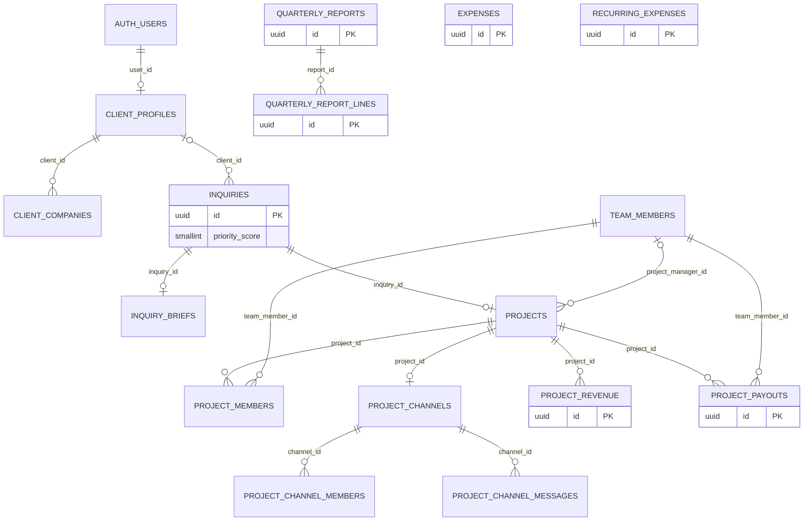

# Database and Supabase

This document describes the database schema created by the committed migrations,
the behavior wired to it, and the known gaps between schema and application UI.

Review local and private operational notes before applying anything to a hosted
Kiln-Studio project.

# Schema Visualiser

## Table `inquiries`

### Columns

| Name | Type | Constraints |
|------|------|-------------|
| `id` | `uuid` | Primary |
| `name` | `text` |  |
| `email` | `text` |  |
| `company` | `text` |  Nullable |
| `service` | `text` |  Nullable |
| `project_brief` | `text` |  |
| `budget_range` | `text` |  Nullable |
| `timeline` | `text` |  Nullable |
| `status` | `text` |  |
| `created_at` | `timestamptz` |  |
| `updated_at` | `timestamptz` |  |
| `client_id` | `uuid` |  Nullable |
| `priority_score` | `int2` |  |
| `similarity_opt_in` | `bool` |  |
| `similarity_opted_in_at` | `timestamptz` |  Nullable |
| `similarity_status` | `text` |  |
| `similarity_matches` | `jsonb` |  |
| `reviewed_complexity` | `int2` |  Nullable |
| `actual_hours` | `numeric` |  Nullable |
| `review_notes` | `text` |  Nullable |

## Table `engagements`

One lifecycle-review row per inquiry. New inquiries create a pending
engagement; existing `new` and `contacted` inquiries are backfilled by
`20261112100000_add_engagement_review_foundation.sql`.
Deleting a synthetic inquiry for demo retention cascades to its engagement and
transition history.

| Name | Type | Constraints |
|------|------|-------------|
| `id` | `uuid` | Primary |
| `inquiry_id` | `uuid` | Unique, references `inquiries.id`; cascades on deletion |
| `review_state` | `text` | `pending`, `suitable`, `not_suitable`, or `needs_info` |
| `review_notes` | `text` | Nullable, max 2,000 characters |
| `reviewed_by` | `uuid` | Nullable, references `auth.users.id` |
| `reviewed_at` | `timestamptz` | Nullable |
| `deal_lead_id` | `uuid` | Nullable, references `auth.users.id` |
| `claimed_at` | `timestamptz` | Nullable; retained as claim history if the owner is deleted |
| `created_at`, `updated_at` | `timestamptz` | Required |

## Table `engagement_events`

Append-only transition log for creation, review, claim, and studio-member
assignment/reassignment events. It records actor, prior and next state/owner,
notes, and timestamp. Clients and designers do not have read access.

## Table `client_profiles`

### Columns

| Name | Type | Constraints |
|------|------|-------------|
| `id` | `uuid` | Primary |
| `user_id` | `uuid` |  Unique |
| `full_name` | `text` |  |
| `email` | `text` |  Unique |
| `created_at` | `timestamptz` |  |
| `updated_at` | `timestamptz` |  |

## Table `client_companies`

### Columns

| Name | Type | Constraints |
|------|------|-------------|
| `id` | `uuid` | Primary |
| `client_id` | `uuid` |  |
| `company_name` | `text` |  |
| `is_primary` | `bool` |  |
| `created_at` | `timestamptz` |  |
| `updated_at` | `timestamptz` |  |

## Table `project_messages`

### Columns

| Name | Type | Constraints |
|------|------|-------------|
| `id` | `uuid` | Primary |
| `inquiry_id` | `uuid` |  |
| `sender_type` | `text` |  |
| `sender_id` | `uuid` |  Nullable |
| `sender_name` | `text` |  |
| `body` | `text` |  |
| `created_at` | `timestamptz` |  |
| `updated_at` | `timestamptz` |  |

## Table `project_request_logs`

### Columns

| Name | Type | Constraints |
|------|------|-------------|
| `id` | `uuid` | Primary |
| `inquiry_id` | `uuid` |  |
| `created_at` | `timestamptz` |  |
| `completed_at` | `timestamptz` |  Nullable |
| `payout_amount` | `numeric` |  |
| `payout_currency` | `text` |  |
| `status` | `text` |  |
| `notes` | `text` |  Nullable |

## Table `company_expenses`

### Columns

| Name | Type | Constraints |
|------|------|-------------|
| `id` | `uuid` | Primary |
| `inquiry_id` | `uuid` |  Nullable |
| `gross_revenue` | `numeric` |  |
| `total_paid_out` | `numeric` |  |
| `contributor_name` | `text` |  |
| `contributor_amount` | `numeric` |  |
| `contributor_role` | `text` |  Nullable |
| `created_at` | `timestamptz` |  |
| `updated_at` | `timestamptz` |  |

## Table `team_members`

### Columns

| Name | Type | Constraints |
|------|------|-------------|
| `id` | `uuid` | Primary |
| `user_id` | `uuid` |  Unique |
| `full_name` | `text` |  |
| `email` | `text` |  Unique |
| `title` | `text` |  Nullable |
| `specialty` | `text` |  Nullable |
| `availability_status` | `text` |  |
| `is_active` | `bool` |  |
| `created_at` | `timestamptz` |  |
| `updated_at` | `timestamptz` |  |

## Table `project_assignments`

### Columns

| Name | Type | Constraints |
|------|------|-------------|
| `id` | `uuid` | Primary |
| `inquiry_id` | `uuid` |  |
| `team_member_id` | `uuid` |  |
| `role_name` | `text` |  |
| `is_project_manager` | `bool` |  |
| `assigned_at` | `timestamptz` |  |

## Table `project_channels`

### Columns

| Name | Type | Constraints |
|------|------|-------------|
| `id` | `uuid` | Primary |
| `inquiry_id` | `uuid` |  Nullable |
| `channel_name` | `text` |  |
| `channel_type` | `text` |  |
| `moderator_member_id` | `uuid` |  Nullable |
| `created_at` | `timestamptz` |  |
| `updated_at` | `timestamptz` |  |
| `project_id` | `uuid` |  Nullable |
| `is_archived` | `bool` |  |
| `description` | `text` |  |

## Table `project_channel_members`

### Columns

| Name | Type | Constraints |
|------|------|-------------|
| `id` | `uuid` | Primary |
| `channel_id` | `uuid` |  |
| `team_member_id` | `uuid` |  |
| `joined_at` | `timestamptz` |  |
| `role` | `text` |  |

## Table `project_channel_messages`

### Columns

| Name | Type | Constraints |
|------|------|-------------|
| `id` | `uuid` | Primary |
| `channel_id` | `uuid` |  |
| `sender_member_id` | `uuid` |  Nullable |
| `sender_name` | `text` |  |
| `sender_role` | `text` |  Nullable |
| `body` | `text` |  |
| `created_at` | `timestamptz` |  |
| `message_source` | `text` |  |

## Table `inquiry_briefs`

### Columns

| Name | Type | Constraints |
|------|------|-------------|
| `id` | `uuid` | Primary |
| `inquiry_id` | `uuid` |  Unique |
| `design_goal` | `text` |  |
| `brand_message` | `text` |  |
| `target_audience` | `text` |  Nullable |
| `desired_outcomes` | `text` |  Nullable |
| `references` | `text` |  Nullable |
| `time_budget` | `text` |  Nullable |
| `design_complexity` | `int2` |  Nullable |
| `created_at` | `timestamptz` |  |
| `updated_at` | `timestamptz` |  |

## Table `projects`

### Columns

| Name | Type | Constraints |
|------|------|-------------|
| `id` | `uuid` | Primary |
| `inquiry_id` | `uuid` |  Unique |
| `project_name` | `text` |  |
| `deadline_date` | `date` |  Nullable |
| `project_manager_id` | `uuid` |  Nullable |
| `accepted_at` | `timestamptz` |  |
| `created_by` | `uuid` |  Nullable |
| `created_at` | `timestamptz` |  |
| `updated_at` | `timestamptz` |  |
| `status` | `text` |  |
| `completed_at` | `timestamptz` |  Nullable |

## Table `project_members`

### Columns

| Name | Type | Constraints |
|------|------|-------------|
| `id` | `uuid` | Primary |
| `project_id` | `uuid` |  |
| `team_member_id` | `uuid` |  |
| `role_name` | `text` |  |
| `created_at` | `timestamptz` |  |
| `updated_at` | `timestamptz` |  |

## Table `system_activity_logs`

### Columns

| Name | Type | Constraints |
|------|------|-------------|
| `id` | `uuid` | Primary |
| `channel_id` | `uuid` |  |
| `table_name` | `text` |  |
| `record_id` | `uuid` |  Nullable |
| `operation` | `text` |  |
| `changed_columns` | `_text` |  |
| `actor_user_id` | `uuid` |  Nullable |
| `occurred_at` | `timestamptz` |  |

## Table `project_revenue`

### Columns

| Name | Type | Constraints |
|------|------|-------------|
| `id` | `uuid` | Primary |
| `project_id` | `uuid` |  |
| `entry_type` | `text` |  |
| `amount` | `numeric` |  |
| `currency` | `text` |  |
| `received_on` | `date` |  |
| `description` | `text` |  Nullable |
| `created_by` | `uuid` |  Nullable |
| `created_at` | `timestamptz` |  |

## Table `project_payouts`

### Columns

| Name | Type | Constraints |
|------|------|-------------|
| `id` | `uuid` | Primary |
| `project_id` | `uuid` |  |
| `team_member_id` | `uuid` |  |
| `role_name` | `text` |  |
| `entry_type` | `text` |  |
| `amount` | `numeric` |  |
| `currency` | `text` |  |
| `status` | `text` |  |
| `paid_on` | `date` |  Nullable |
| `notes` | `text` |  Nullable |
| `created_by` | `uuid` |  Nullable |
| `created_at` | `timestamptz` |  |

## Table `expenses`

### Columns

| Name | Type | Constraints |
|------|------|-------------|
| `id` | `uuid` | Primary |
| `name` | `text` |  |
| `category` | `expense_category` |  |
| `amount` | `numeric` |  |
| `currency` | `text` |  |
| `incurred_on` | `date` |  |
| `notes` | `text` |  Nullable |
| `voided_at` | `timestamptz` |  Nullable |
| `void_reason` | `text` |  Nullable |
| `created_by` | `uuid` |  Nullable |
| `created_at` | `timestamptz` |  |
| `updated_at` | `timestamptz` |  |

## Table `recurring_expenses`

### Columns

| Name | Type | Constraints |
|------|------|-------------|
| `id` | `uuid` | Primary |
| `name` | `text` |  |
| `category` | `expense_category` |  |
| `amount` | `numeric` |  |
| `currency` | `text` |  |
| `frequency` | `text` |  |
| `starts_on` | `date` |  |
| `ends_on` | `date` |  Nullable |
| `notes` | `text` |  Nullable |
| `voided_at` | `timestamptz` |  Nullable |
| `void_reason` | `text` |  Nullable |
| `created_by` | `uuid` |  Nullable |
| `created_at` | `timestamptz` |  |
| `updated_at` | `timestamptz` |  |

## Table `quarterly_reports`

### Columns

| Name | Type | Constraints |
|------|------|-------------|
| `id` | `uuid` | Primary |
| `period_year` | `int2` |  |
| `period_quarter` | `int2` |  |
| `version` | `int4` |  |
| `supersedes_report_id` | `uuid` |  Nullable |
| `period_start` | `date` |  |
| `period_end` | `date` |  |
| `currency` | `text` |  |
| `total_revenue` | `numeric` |  |
| `total_payouts` | `numeric` |  |
| `total_expenses` | `numeric` |  |
| `total_recurring_expenses` | `numeric` |  |
| `net_result` | `numeric` |  |
| `status` | `text` |  |
| `generated_at` | `timestamptz` |  |
| `published_at` | `timestamptz` |  Nullable |
| `published_by` | `uuid` |  Nullable |
| `created_at` | `timestamptz` |  |

## Table `quarterly_report_lines`

### Columns

| Name | Type | Constraints |
|------|------|-------------|
| `id` | `uuid` | Primary |
| `report_id` | `uuid` |  |
| `line_type` | `text` |  |
| `project_id` | `uuid` |  Nullable |
| `label` | `text` |  |
| `amount` | `numeric` |  |
| `created_at` | `timestamptz` |  |

## Table `slack_installations`

### Columns

| Name | Type | Constraints |
|------|------|-------------|
| `id` | `bool` | Primary |
| `workspace_id` | `text` |  Unique |
| `workspace_name` | `text` |  |
| `bot_user_id` | `text` |  |
| `encrypted_bot_token` | `text` |  Nullable |
| `installed_by` | `uuid` |  |
| `installed_at` | `timestamptz` |  |
| `updated_at` | `timestamptz` |  |
| `is_active` | `bool` |  |

## Table `slack_user_mappings`

### Columns

| Name | Type | Constraints |
|------|------|-------------|
| `team_member_id` | `uuid` | Primary |
| `slack_user_id` | `text` |  Unique |
| `verified_at` | `timestamptz` |  |
| `linked_by` | `uuid` |  |

## Table `slack_project_channels`

### Columns

| Name | Type | Constraints |
|------|------|-------------|
| `project_id` | `uuid` | Primary |
| `slack_channel_id` | `text` |  Unique |
| `slack_channel_name` | `text` |  |
| `synced_at` | `timestamptz` |  |

## Table `slack_project_sync_jobs`

### Columns

| Name | Type | Constraints |
|------|------|-------------|
| `project_id` | `uuid` | Primary |
| `action` | `text` |  |
| `status` | `text` |  |
| `attempt_count` | `int4` |  |
| `available_at` | `timestamptz` |  |
| `claimed_at` | `timestamptz` |  Nullable |
| `last_error` | `text` |  Nullable |
| `updated_at` | `timestamptz` |  |

## Table `slack_message_outbox`

### Columns

| Name | Type | Constraints |
|------|------|-------------|
| `id` | `uuid` | Primary |
| `project_id` | `uuid` |  |
| `project_channel_message_id` | `uuid` |  Unique |
| `status` | `text` |  |
| `attempt_count` | `int4` |  |
| `available_at` | `timestamptz` |  |
| `claimed_at` | `timestamptz` |  Nullable |
| `slack_message_ts` | `text` |  Nullable |
| `last_error` | `text` |  Nullable |
| `created_at` | `timestamptz` |  |
| `updated_at` | `timestamptz` |  |

## Table `slack_event_receipts`

### Columns

| Name | Type | Constraints |
|------|------|-------------|
| `event_id` | `text` | Primary |
| `outcome` | `text` |  |
| `provider_channel_id` | `text` |  Nullable |
| `provider_message_ts` | `text` |  Nullable |
| `received_at` | `timestamptz` |  |
| `processed_at` | `timestamptz` |  Nullable |

## Table `slack_provider_messages`

### Columns

| Name | Type | Constraints |
|------|------|-------------|
| `provider_channel_id` | `text` | Primary |
| `provider_message_ts` | `text` | Primary |
| `project_channel_message_id` | `uuid` |  Unique |

## Table `inquiry_reference_files`

### Columns

| Name | Type | Constraints |
|------|------|-------------|
| `id` | `uuid` | Primary |
| `inquiry_id` | `uuid` |  Nullable |
| `object_path` | `text` |  Unique |
| `file_name` | `text` |  |
| `content_type` | `text` |  |
| `byte_size` | `int4` |  |
| `status` | `text` |  |
| `failure_reason` | `text` |  Nullable |
| `created_at` | `timestamptz` |  |
| `processed_at` | `timestamptz` |  Nullable |

## Custom Types / Enums

### `expense_category`

`software` | `rent` | `tools` | `equipment` | `services` | `travel` | `other`

## RLS Policies

### `inquiries`

| Policy | Command | Roles | Action | USING | WITH CHECK |
|--------|---------|-------|--------|-------|------------|
| `Studio members can read inquiries` | SELECT | authenticated | PERMISSIVE | `(((auth.jwt() -> 'app_metadata'::text) ->> 'access_level'::text) = 'studio_member'::text)` | — |
| `inquiries_select_for_assigned_designers` | SELECT | authenticated | PERMISSIVE | Designers may read only inquiries authorized by `can_access_inquiry_project(id)`. | — |
| `Studio members can update inquiry status` | UPDATE | authenticated | PERMISSIVE | `(((auth.jwt() -> 'app_metadata'::text) ->> 'access_level'::text) = 'studio_member'::text)` | `(((auth.jwt() -> 'app_metadata'::text) ->> 'access_level'::text) = 'studio_member'::text)` |
| `Clients can read their own inquiries` | SELECT | authenticated | PERMISSIVE | `((((auth.jwt() -> 'app_metadata'::text) ->> 'access_level'::text) = 'client'::text) AND (client_id IS NOT NULL) AND (client_id IN ( SELECT cp.id    FROM client_profiles cp   WHERE (cp.user_id = auth.uid()))))` | — |
| `Clients can insert their own inquiries` | INSERT | authenticated | PERMISSIVE | — | `((((auth.jwt() -> 'app_metadata'::text) ->> 'access_level'::text) = 'client'::text) AND (client_id IS NOT NULL) AND (client_id IN ( SELECT cp.id    FROM client_profiles cp   WHERE (cp.user_id = auth.uid()))))` |

### `client_profiles`

| Policy | Command | Roles | Action | USING | WITH CHECK |
|--------|---------|-------|--------|-------|------------|
| `Clients can view their own profile` | SELECT | authenticated | PERMISSIVE | `(user_id = auth.uid())` | — |
| `Clients can update their own profile` | UPDATE | authenticated | PERMISSIVE | `(user_id = auth.uid())` | `(user_id = auth.uid())` |
| `Clients can insert their own profile` | INSERT | authenticated | PERMISSIVE | — | `(user_id = auth.uid())` |

### `client_companies`

| Policy | Command | Roles | Action | USING | WITH CHECK |
|--------|---------|-------|--------|-------|------------|
| `Clients can view their own companies` | SELECT | authenticated | PERMISSIVE | `(client_id IN ( SELECT cp.id    FROM client_profiles cp   WHERE (cp.user_id = auth.uid())))` | — |
| `Clients can insert their own companies` | INSERT | authenticated | PERMISSIVE | — | `(client_id IN ( SELECT cp.id    FROM client_profiles cp   WHERE (cp.user_id = auth.uid())))` |
| `Clients can update their own companies` | UPDATE | authenticated | PERMISSIVE | `(client_id IN ( SELECT cp.id    FROM client_profiles cp   WHERE (cp.user_id = auth.uid())))` | `(client_id IN ( SELECT cp.id    FROM client_profiles cp   WHERE (cp.user_id = auth.uid())))` |

### `inquiry_briefs`

| Policy | Command | Roles | Action | USING | WITH CHECK |
|--------|---------|-------|--------|-------|------------|
| `project_briefs_select_for_studio_or_assigned_designers` | SELECT | authenticated | PERMISSIVE | Studio members or designers assigned through `project_members`. | — |
| `project_briefs_insert_for_service_role` | INSERT | service_role | PERMISSIVE | — | `true` |
| `project_briefs_update_for_service_role` | UPDATE | service_role | PERMISSIVE | `true` | `true` |

### `projects`

| Policy | Command | Roles | Action | USING | WITH CHECK |
|--------|---------|-------|--------|-------|------------|
| `projects_select_for_studio` | SELECT | authenticated | PERMISSIVE | Studio members or designers assigned to the linked inquiry. | — |
| `projects_update_for_admin_or_pm` | UPDATE | authenticated | PERMISSIVE | `((((auth.jwt() -> 'app_metadata'::text) ->> 'access_level'::text) = 'studio_member'::text) OR is_project_manager(id))` | `((((auth.jwt() -> 'app_metadata'::text) ->> 'access_level'::text) = 'studio_member'::text) OR is_project_manager(id))` |

### `project_members`

| Policy | Command | Roles | Action | USING | WITH CHECK |
|--------|---------|-------|--------|-------|------------|
| `project_members_select_for_studio` | SELECT | authenticated | PERMISSIVE | Studio members or designers assigned to the project. | — |
| `project_members_delete_for_admin_or_pm` | DELETE | authenticated | PERMISSIVE | `((role_name <> 'PROJECT_MANAGER'::text) AND ((((auth.jwt() -> 'app_metadata'::text) ->> 'access_level'::text) = 'studio_member'::text) OR is_project_manager(project_id)))` | — |
| `project_members_insert_for_admin_or_pm` | INSERT | authenticated | PERMISSIVE | — | `((role_name <> 'PROJECT_MANAGER'::text) AND (EXISTS ( SELECT 1    FROM projects   WHERE ((projects.id = project_members.project_id) AND (projects.status = 'active'::text)))) AND ((((( SELECT auth.jwt() AS jwt) -> 'app_metadata'::text) ->> 'access_level'::text) = 'studio_member'::text) OR is_project_manager(project_id)))` |
| `project_members_update_for_admin_or_pm` | UPDATE | authenticated | PERMISSIVE | `((role_name <> 'PROJECT_MANAGER'::text) AND (EXISTS ( SELECT 1    FROM projects   WHERE ((projects.id = project_members.project_id) AND (projects.status = 'active'::text)))) AND ((((( SELECT auth.jwt() AS jwt) -> 'app_metadata'::text) ->> 'access_level'::text) = 'studio_member'::text) OR is_project_manager(project_id)))` | `((role_name <> 'PROJECT_MANAGER'::text) AND (EXISTS ( SELECT 1    FROM projects   WHERE ((projects.id = project_members.project_id) AND (projects.status = 'active'::text)))) AND ((((( SELECT auth.jwt() AS jwt) -> 'app_metadata'::text) ->> 'access_level'::text) = 'studio_member'::text) OR is_project_manager(project_id)))` |

### `project_channel_members`

| Policy | Command | Roles | Action | USING | WITH CHECK |
|--------|---------|-------|--------|-------|------------|
| `project_channel_members_select_for_studio` | SELECT | authenticated | PERMISSIVE | `((auth.uid() IS NOT NULL) AND (COALESCE(((auth.jwt() -> 'app_metadata'::text) ->> 'access_level'::text), (auth.jwt() ->> 'role'::text)) = ANY (ARRAY['studio_member'::text, 'designer'::text])) AND ((EXISTS ( SELECT 1    FROM project_channels channels   WHERE ((channels.id = project_channel_members.channel_id) AND (channels.channel_type = ANY (ARRAY['general'::text, 'announcement'::text, 'system'::text]))))) OR is_project_channel_member(channel_id)))` | — |

### `project_channel_messages`

| Policy | Command | Roles | Action | USING | WITH CHECK |
|--------|---------|-------|--------|-------|------------|
| `project_channel_messages_select_for_studio` | SELECT | authenticated | PERMISSIVE | `((EXISTS ( SELECT 1    FROM project_channels channels   WHERE ((channels.id = project_channel_messages.channel_id) AND ((channels.channel_type = ANY (ARRAY['general'::text, 'announcement'::text, 'system'::text])) OR is_project_channel_member(channels.id))))) AND (COALESCE(((auth.jwt() -> 'app_metadata'::text) ->> 'access_level'::text), (auth.jwt() ->> 'role'::text)) = ANY (ARRAY['studio_member'::text, 'designer'::text])))` | — |
| `project_channel_messages_insert_for_studio` | INSERT | authenticated | PERMISSIVE | — | `((EXISTS ( SELECT 1    FROM project_channels channels   WHERE ((channels.id = project_channel_messages.channel_id) AND ((channels.channel_type = 'general'::text) OR ((channels.channel_type = 'announcement'::text) AND (((auth.jwt() -> 'app_metadata'::text) ->> 'access_level'::text) = 'studio_member'::text)) OR ((channels.channel_type = 'project'::text) AND (channels.is_archived = false) AND is_project_channel_member(channels.id)))))) AND (COALESCE(((auth.jwt() -> 'app_metadata'::text) ->> 'access_level'::text), (auth.jwt() ->> 'role'::text)) = ANY (ARRAY['studio_member'::text, 'designer'::text])) AND (EXISTS ( SELECT 1    FROM team_members team   WHERE ((team.id = project_channel_messages.sender_member_id) AND (team.user_id = auth.uid()) AND (team.full_name = project_channel_messages.sender_name)))))` |

### `project_channels`

| Policy | Command | Roles | Action | USING | WITH CHECK |
|--------|---------|-------|--------|-------|------------|
| `project_channels_select_for_studio` | SELECT | authenticated | PERMISSIVE | `((auth.uid() IS NOT NULL) AND (COALESCE(((auth.jwt() -> 'app_metadata'::text) ->> 'access_level'::text), (auth.jwt() ->> 'role'::text)) = ANY (ARRAY['studio_member'::text, 'designer'::text])) AND ((channel_type = ANY (ARRAY['general'::text, 'announcement'::text, 'system'::text])) OR ((project_id IS NOT NULL) AND is_project_channel_member(id))))` | — |

### `team_members`

| Policy | Command | Roles | Action | USING | WITH CHECK |
|--------|---------|-------|--------|-------|------------|
| `team_members_select_for_studio` | SELECT | authenticated | PERMISSIVE | `(((( SELECT auth.jwt() AS jwt) -> 'app_metadata'::text) ->> 'access_level'::text) = ANY (ARRAY['designer'::text, 'studio_member'::text]))` | — |

### `project_assignments`

| Policy | Command | Roles | Action | USING | WITH CHECK |
|--------|---------|-------|--------|-------|------------|
| `project_assignments_select_for_studio` | SELECT | authenticated | PERMISSIVE | Studio members only; legacy assignment rows are not used by designer pages. | — |

### `project_messages`

| Policy | Command | Roles | Action | USING | WITH CHECK |
|--------|---------|-------|--------|-------|------------|
| `project_messages_select_for_designers` | SELECT | authenticated | PERMISSIVE | Studio members, or designers for inquiries authorized by `can_access_inquiry_project(inquiry_id)`. | — |
| `project_messages_insert_for_designers` | INSERT | authenticated | PERMISSIVE | — | Studio members, or assigned designers; sender type and identity are checked separately. |

### `project_request_logs`

| Policy | Command | Roles | Action | USING | WITH CHECK |
|--------|---------|-------|--------|-------|------------|
| `project_request_logs_select_for_studio` | SELECT | authenticated | PERMISSIVE | Studio members only. | — |

### `company_expenses`

| Policy | Command | Roles | Action | USING | WITH CHECK |
|--------|---------|-------|--------|-------|------------|
| `company_expenses_select_for_studio` | SELECT | authenticated | PERMISSIVE | Studio members only. | — |

### `system_activity_logs`

| Policy | Command | Roles | Action | USING | WITH CHECK |
|--------|---------|-------|--------|-------|------------|
| `system_activity_logs_select_for_studio` | SELECT | authenticated | PERMISSIVE | `((auth.uid() IS NOT NULL) AND (((auth.jwt() -> 'app_metadata'::text) ->> 'access_level'::text) = 'studio_member'::text))` | — |

### `project_revenue`

| Policy | Command | Roles | Action | USING | WITH CHECK |
|--------|---------|-------|--------|-------|------------|
| `project_revenue_studio_only` | SELECT | authenticated | PERMISSIVE | `(((auth.jwt() -> 'app_metadata'::text) ->> 'access_level'::text) = 'studio_member'::text)` | — |
| `project_revenue_insert_studio_only` | INSERT | authenticated | PERMISSIVE | — | `(((auth.jwt() -> 'app_metadata'::text) ->> 'access_level'::text) = 'studio_member'::text)` |

### `project_payouts`

| Policy | Command | Roles | Action | USING | WITH CHECK |
|--------|---------|-------|--------|-------|------------|
| `project_payouts_studio_only` | SELECT | authenticated | PERMISSIVE | `(((auth.jwt() -> 'app_metadata'::text) ->> 'access_level'::text) = 'studio_member'::text)` | — |
| `project_payouts_insert_studio_only` | INSERT | authenticated | PERMISSIVE | — | `(((auth.jwt() -> 'app_metadata'::text) ->> 'access_level'::text) = 'studio_member'::text)` |
| `project_payouts_update_studio_only` | UPDATE | authenticated | PERMISSIVE | `(((auth.jwt() -> 'app_metadata'::text) ->> 'access_level'::text) = 'studio_member'::text)` | `(((auth.jwt() -> 'app_metadata'::text) ->> 'access_level'::text) = 'studio_member'::text)` |

### `expenses`

| Policy | Command | Roles | Action | USING | WITH CHECK |
|--------|---------|-------|--------|-------|------------|
| `expenses_studio_only` | SELECT | authenticated | PERMISSIVE | `(((auth.jwt() -> 'app_metadata'::text) ->> 'access_level'::text) = 'studio_member'::text)` | — |
| `expenses_insert_studio_only` | INSERT | authenticated | PERMISSIVE | — | `(((auth.jwt() -> 'app_metadata'::text) ->> 'access_level'::text) = 'studio_member'::text)` |

### `recurring_expenses`

| Policy | Command | Roles | Action | USING | WITH CHECK |
|--------|---------|-------|--------|-------|------------|
| `recurring_expenses_studio_only` | SELECT | authenticated | PERMISSIVE | `(((auth.jwt() -> 'app_metadata'::text) ->> 'access_level'::text) = 'studio_member'::text)` | — |
| `recurring_expenses_insert_studio_only` | INSERT | authenticated | PERMISSIVE | — | `(((auth.jwt() -> 'app_metadata'::text) ->> 'access_level'::text) = 'studio_member'::text)` |

### `quarterly_reports`

| Policy | Command | Roles | Action | USING | WITH CHECK |
|--------|---------|-------|--------|-------|------------|
| `quarterly_reports_studio_only` | SELECT | authenticated | PERMISSIVE | `(((auth.jwt() -> 'app_metadata'::text) ->> 'access_level'::text) = 'studio_member'::text)` | — |

### `quarterly_report_lines`

| Policy | Command | Roles | Action | USING | WITH CHECK |
|--------|---------|-------|--------|-------|------------|
| `quarterly_report_lines_studio_only` | SELECT | authenticated | PERMISSIVE | `(EXISTS ( SELECT 1    FROM quarterly_reports reports   WHERE ((reports.id = quarterly_report_lines.report_id) AND (((auth.jwt() -> 'app_metadata'::text) ->> 'access_level'::text) = 'studio_member'::text))))` | — |


## Contents

- [Database and Supabase](#database-and-supabase)
  - [Contents](#contents)
  - [Database responsibilities](#database-responsibilities)
  - [Demo versus production](#demo-versus-production)
  - [Naming notes](#naming-notes)
  - [Data model](#data-model)
  - [Migration sequence](#migration-sequence)
  - [Hosted Kiln-Studio rollout](#hosted-kiln-studio-rollout)
  - [Current tables (committed)](#current-tables-committed)
  - [Inquiry, priority and project flow](#inquiry-priority-and-project-flow)
  - [Audit trail (system activity)](#audit-trail-system-activity)
  - [Inquiry priority](#inquiry-priority)
    - [Model](#model)
  - [Project finance and quarterly reports](#project-finance-and-quarterly-reports)
    - [Net result](#net-result)
    - [Tables](#tables)
    - [Studio-member database access (append-only)](#studio-member-database-access-append-only)
    - [Voiding and ending expenses](#voiding-and-ending-expenses)
    - [Corrections and published reports](#corrections-and-published-reports)
    - [Access](#access)
    - [Retiring the old finance tables](#retiring-the-old-finance-tables)
    - [Current assumptions and UI gap](#current-assumptions-and-ui-gap)
  - [Client ownership and companies](#client-ownership-and-companies)
  - [Access model and known limitations](#access-model-and-known-limitations)
  - [RLS and grants verification](#rls-and-grants-verification)
  - [Local setup and migration workflow](#local-setup-and-migration-workflow)
  - [Retention and sensitive data](#retention-and-sensitive-data)

## Database responsibilities

Supabase Auth stores credentials and issues user sessions. PostgreSQL stores
inquiries, client profiles/companies, extended inquiry briefs and priority,
inquiry messages, basic financial tracking, and the team/channel/project model.
The Next.js server performs validation and authorization; PostgreSQL grants and
RLS provide the database boundary.

Three layers decide every request, in this order:

1. **Grants** decide which role may touch which table or column at all.
2. **RLS policies** decide which rows that role may touch. They read the
   trusted `app_metadata.access_level` claim (`client`, `designer`,
   `studio_member`) through `auth.jwt()`.
3. **Triggers** automate behavior. Most are `SECURITY DEFINER`, so they run as
   the table owner and bypass layers 1 and 2. That is intentional (it is how
   accepting an inquiry can create rows the caller cannot insert directly), but
   it means trigger bodies deserve the same review as policies.

## Demo versus production

Kiln Studio's Postgres channel tables own project membership and durable
message history. Slack is an optional transport/collaboration mirror, not a
replacement for these records. The app remains usable when Slack is unavailable.

What that implies for the database:

- Inquiries, projects, project members, channels, messages, finance and reports
  stay the source of truth. Slack is a delivery surface, not their data store.
- `slack_project_channels` maps each eligible app project channel to a private
  Slack channel. Database triggers enqueue channel creation and membership
  reconciliation; a server-side worker performs Slack API calls.
- The audit trail (see [Audit trail](#audit-trail-system-activity)) stays in the
  database. The admin activity feed could additionally be posted to a Slack
  channel.
- App messages enter Postgres first, then an outbox worker sends them to Slack.
  Verified Slack message events are deduplicated and stored in Postgres before
  the app Realtime feed delivers them to website clients.
- Slack's standard channel APIs do not expose the database's per-project
  moderator/role controls. Keep permissions enforced by app authorization and
  RLS; Slack channel membership only mirrors active, linked project members.

## Naming notes

- The accepted-inquiry entity is called **project**: `projects`, `project_members`,
  and `project_channels.project_id`.
- `product_design` is a **service category** value in `inquiries.service`. It is
  intentionally retained and is not the name of a database entity.
- `project_messages`, `project_assignments`, `project_request_logs` and
  `inquiry_briefs` are **inquiry-scoped**: they reference `inquiry_id`, not a
  project. The `project_` prefix is misleading next to the `projects` table.
  This document says "inquiry messages" and "project channel messages" to keep
  the two apart.
- Migration 13 renamed `project_briefs` to `inquiry_briefs` and moved priority
  onto `inquiries`. Other inquiry-scoped tables retain their legacy names for
  compatibility; do not rename applied migration files.
- Migration 14 adds `system_activity_logs` to the Realtime publication. The
  admin dashboard uses the cookie-bound Supabase client; Realtime events and
  history reads remain subject to the studio-member RLS policy.
- Migration 15 restricts project membership additions and role changes to
  active projects; membership removal remains available after completion to
  revoke channel-history access.

## Data model

Everything hangs off two anchors: `inquiries` (the customer side) and
`team_members` (the studio side). `projects` is where they meet.



Finance entities and `inquiries.priority_score` are described in their own
sections. `EXPENSES` and `RECURRING_EXPENSES` are company-wide with no foreign
key to a project, so they are not drawn. The audit table
`system_activity_logs` is also left out on purpose: it is connected to
operational tables by triggers, not by foreign keys.

## Migration sequence

**Committed.** The canonical migration files are applied in timestamp order:

1. [`20261107000000_create_inquiries.sql`](../supabase/migrations/20261107000000_create_inquiries.sql): creates the inquiry table, constraints, indexes, update trigger, and initial inquiry policies.
2. [`20261107010000_client_accounts_and_project_access.sql`](../supabase/migrations/20261107010000_client_accounts_and_project_access.sql): adds client profiles, links inquiries to clients, and adds client-scoped access.
3. [`20261107020000_client_company_relationships.sql`](../supabase/migrations/20261107020000_client_company_relationships.sql): adds client-company records and moves the optional company value out of the profile.
4. [`20261107030000_designer_messages_and_finance_tracking.sql`](../supabase/migrations/20261107030000_designer_messages_and_finance_tracking.sql): adds inquiry messages and the first finance-tracking tables.
5. [`20261107040000_team_roles_and_channels.sql`](../supabase/migrations/20261107040000_team_roles_and_channels.sql): adds the initial team, assignment, channel, and channel-message tables.
6. [`20261107050000_team_statuses_and_channel_roles.sql`](../supabase/migrations/20261107050000_team_statuses_and_channel_roles.sql): maps legacy availability values, resolves duplicate legacy PM flags, and constrains availability and channel roles.
7. [`20261107060000_project_briefs_priority.sql`](../supabase/migrations/20261107060000_project_briefs_priority.sql): adds extended briefs and priority scoring.
8. [`20261108000000_projects_and_system_activity.sql`](../supabase/migrations/20261108000000_projects_and_system_activity.sql): adds accepted-inquiry projects, deadlines, project teams, project channels, completion/archive rules, channel ordering, and system activity auditing.
9. [`20261108010000_harden_table_grants.sql`](../supabase/migrations/20261108010000_harden_table_grants.sql): revokes the default grants (including `TRUNCATE`, which bypasses RLS) on the eight tables from migrations 4 and 5, re-grants only `SELECT` plus column-level `INSERT`, and pins the `search_path` of the shared `updated_at` function.
10. [`20261108020000_fix_studio_access_policies.sql`](../supabase/migrations/20261108020000_fix_studio_access_policies.sql): fixes policies from migrations 4 and 5 that read a top-level `access_level` claim instead of `app_metadata`, which locked designers and studio members out of those tables.
11. [`20261108030000_allow_project_brief_upserts.sql`](../supabase/migrations/20261108030000_allow_project_brief_upserts.sql): grants the service role the table read permission PostgreSQL requires for project-brief upserts.
12. [`20261108040000_enforce_message_sender_identity.sql`](../supabase/migrations/20261108040000_enforce_message_sender_identity.sql): prevents sender impersonation on inquiry and channel messages and preserves the archived-project-channel write lock.
13. [`20261108050000_align_inquiry_priority_and_finance.sql`](../supabase/migrations/20261108050000_align_inquiry_priority_and_finance.sql): renames `project_briefs` to `inquiry_briefs`, moves priority to inquiries, creates an atomic inquiry/brief RPC, restricts activity-feed access to studio members, and adds normalized project-finance and quarterly-report tables/functions.
14. [`20261108060000_enable_system_activity_realtime.sql`](../supabase/migrations/20261108060000_enable_system_activity_realtime.sql): adds `system_activity_logs` to the Supabase Realtime publication.
15. [`20261108070000_restrict_membership_changes_to_active_projects.sql`](../supabase/migrations/20261108070000_restrict_membership_changes_to_active_projects.sql): prevents project member additions or role changes after completion while allowing membership removal to revoke access.
16. [`20261108080000_add_slack_sync_foundation.sql`](../supabase/migrations/20261108080000_add_slack_sync_foundation.sql): adds encrypted Slack installation and user mappings, project channel mappings, message outbox, event receipts, and service-only synchronization functions.
17. [`20261108090000_enable_project_message_realtime.sql`](../supabase/migrations/20261108090000_enable_project_message_realtime.sql): adds project chat messages to Realtime and reclaims stale sync/outbox jobs.
18. [`20261109000000_reconcile_slack_project_members.sql`](../supabase/migrations/20261109000000_reconcile_slack_project_members.sql): reconciles Slack channel membership after project membership, account-link, team-active-state, and workspace-installation changes; supports installation revocation and reconnection.
19. [`20261109010000_add_inquiry_reference_uploads.sql`](../supabase/migrations/20261109010000_add_inquiry_reference_uploads.sql): creates a private image bucket and server-only reference metadata; links uploads atomically to inquiries and queues verification.
20. [`20261109020000_add_opt_in_inquiry_similarity.sql`](../supabase/migrations/20261109020000_add_opt_in_inquiry_similarity.sql): adds explicit consent, advisory match state, and human review fields while preserving atomic inquiry creation.
21. [`20261111000000_add_customer_support_messages.sql`](../supabase/migrations/20261111000000_add_customer_support_messages.sql): creates a small, service-role-only table for idempotent public support question/answer pairs without separate account/IP metadata; submitted text is not scrubbed.
22. [`20261111010000_allow_idempotent_support_message_upserts.sql`](../supabase/migrations/20261111010000_allow_idempotent_support_message_upserts.sql): grants the service role column-level `SELECT` on `request_id`, which PostgreSQL requires for the idempotent upsert conflict check, without granting reads of question or answer text.
23. [`20261111020000_claim_slack_outbox_message.sql`](../supabase/migrations/20261111020000_claim_slack_outbox_message.sql): adds an atomic service-role-only claim function for one Slack outbox message, used by QStash-triggered delivery and safe against concurrent/repeated claims.

Migrations 9 to 12 harden and refine migration 8; migrations 13 to 15 finalize
inquiry priority, activity-feed access/Realtime, finance, and project-team
membership boundaries. Migrations 16 to 18 add the optional Slack sync layer while keeping Postgres
authoritative. Migration 19 adds private inquiry-reference uploads and their
QStash verification workflow. Migration 20 adds opt-in similarity and human
review data; vector records remain auxiliary and are not relational source data.
Migration 21 stores chatbot Q&A for later manual FAQ curation. It deliberately
does not store account, client, email, or IP metadata; submitted question and
answer text is stored as-is and is not automatically scrubbed. The UI warns
visitors not to include personal or sensitive information. Public roles cannot
read or write this table directly. Migration 22 grants `service_role` access to
only the idempotency key for `ON CONFLICT` handling; question/answer reads
remain ungranted.

Do not treat edits made only in the Supabase dashboard as the source of truth.
Test a fresh database and a database upgraded through the full migration chain.

## Hosted Kiln-Studio rollout

Private operational note: remote project IDs, hosted database names, and any
production reset command belong in a private environment note rather than this
repository. Treat the local, reviewed migration chain in `supabase/migrations/`
as the canonical source of truth for the app schema.

If you need to repair a live project, inspect the hosted database privately,
compare the actual schema against the repository migrations, then apply a
reviewed forward-only migration. Never paste raw remote reset commands or
project identifiers into project docs that are intended for public review.

## Current tables (committed)


| Table | Purpose and current model |
| --- | --- |
| `inquiries` | Public request data, service/budget/timeline, lifecycle status, timestamps, nullable `client_id`, priority score `0-10`, explicit similarity consent/state/matches, and human review fields. |
| `client_profiles` | Supabase user ID, name, email, and timestamps. Does not store a password. |
| `client_companies` | Company names associated with a client; unique per `(client_id, company_name)`. Client sign-up currently accepts zero or one company name. |
| `inquiry_briefs` | One extended design brief per inquiry, including scoring inputs and the approved text fields used for opted-in similarity. Priority is owned by `inquiries`; labels are derived in application code. |
| `inquiry_reference_files` | Private image metadata and processing state for optional inquiry attachments. Unattached upload records are temporary; only studio-server routes may read or mutate metadata. |
| `projects` | One project per accepted inquiry: name, nullable deadline date, PM team-member ID, `active`/`completed` status, completion time, acceptance time, and creator. |
| `project_members` | The project's smaller assigned team; one row per team member per project with that member's role. Exactly one `PROJECT_MANAGER` role is allowed and is synchronized from the project's PM field. |
| `project_messages` | Inquiry-linked messages; insert policies bind sender identity and type to the authenticated user. Inquiry-scoped despite the name. |
| `project_request_logs` | Legacy request logs with payout amount/currency fields. Retained but superseded for new finance records. |
| `company_expenses` | Legacy company revenue, payout, and contributor summaries. Retained but superseded for new finance records. |
| `team_members` | Studio roster identities and availability. |
| `project_assignments` | Associates a team member to an inquiry with a role and PM flag; unique per `(inquiry_id, team_member_id)`. Legacy and inquiry-based; not the source for project teams. |
| `project_channels` | General, announcement, system, or project channel; project channels reference `project_id`, carry a refreshed inquiry/brief description, and can be archived. |
| `project_channel_members` | Associates a team member to a channel with `moderator` or `member` role. |
| `project_channel_messages` | Channel messages; inserts must match the sender's team-member identity and archived project channels reject new posts. |
| `slack_installations` | Single active workspace installation; the bot token is encrypted at rest and cleared on the Slack uninstall event. |
| `slack_user_mappings` | Verified Slack account-to-team-member mapping used for project channel invitations and inbound message attribution. |
| `slack_project_channels` | Maps an app project channel to its private Slack channel. |
| `slack_project_sync_jobs` | Durable channel create/archive/member-reconciliation work with retry state. |
| `slack_message_outbox` | Durable app-to-Slack delivery work, with retry and provider timestamp tracking. |
| `slack_event_receipts`, `slack_provider_messages` | Idempotency receipts and provider-message-to-app-message mapping for inbound Slack events. |
| `customer_support_messages` | Idempotent public chatbot question/answer pairs and Gemini model name for future FAQ curation; stores no separate account/IP metadata, does not scrub submitted text, and is writable only by the server service role. |
| `project_revenue` | Project receipts and refund adjustments. |
| `project_payouts` | Project member payouts, including planned-to-paid transitions and refund adjustments. |
| `expenses` | One-time studio overhead expenses; rows are append-only except for a one-way void operation. |
| `recurring_expenses` | Recurring studio overhead and its date-expanded occurrences. |
| `quarterly_reports`, `quarterly_report_lines` | Immutable published quarter snapshots and their auditable breakdowns. |

`project_request_logs` and `company_expenses` are legacy finance tables. The
current migration retains them rather than guessing how to translate their
summary rows into transaction-level records; do not use them for new finance
entries. A separate forward-only migration can retire them after existing data
is reviewed and reconciled.

The audit table `system_activity_logs` is cross-cutting infrastructure rather
than a domain table; see [Audit trail](#audit-trail-system-activity).

## Inquiry, priority and project flow

`POST /api/inquiries` validates the request with `PublicInquirySchema`, checks
the honeypot and shared rate limit, computes priority using
`computeProjectPriority`, then calls the restricted
`create_public_inquiry_with_references` RPC to insert the inquiry, extended
brief, and selected reference-image links atomically. Optional reference
images are JPEG, PNG, or WebP (up to four, 8 MB each, 24 MB total). Browser
uploads use short-lived signed upload URLs into a private Supabase Storage bucket. QStash
delivers a signature-verified task that checks image bytes against their
declared format; only verified images can receive short-lived admin preview
URLs. If QStash is not configured, development verifies files inline. The
inquiry's status is one of `new`, `contacted`, `accepted`, `in_progress`, or
`closed`.
`accepted` is never the default for a new inquiry.

Inquiries do not become projects at submission. Setting an inquiry's status to
`accepted` creates exactly one project row through a database trigger, which in
turn creates that project's dedicated channel. Inquiries that are not accepted
remain only inquiry records and receive no project channel. A project's
`deadline_date` is nullable until a deadline is assigned. Legacy
inquiry-linked project channels without a corresponding accepted project are
archived by the migration rather than presented as current project rooms.

Chain of triggers when an inquiry is accepted:

1. `inquiries` status becomes `accepted` and the project row is created.
2. The project row creates its channel and refreshes the channel description.
3. When a PM is assigned (admin only), that person is added to `project_members`
   as `PROJECT_MANAGER` and to the channel as `moderator`; a previous PM is
   demoted to `TEAM_MEMBER` / `member`.
4. Adding or removing project members syncs `project_channel_members`.
5. The audit trigger records each of these writes in `system_activity_logs`.

Every project channel description contains the linked inquiry's contact,
company, service, budget, timeline, project brief, priority, and any populated
extended brief fields. It is refreshed when those inquiry or brief details
change.

Projects start `active`. Only the assigned PM can change a project to
`completed`; the database stamps `completed_at` and archives its channel. An
archived channel rejects new channel messages but stays readable to existing
members. A completed project cannot be reopened.

`list_project_channels(p_limit, p_offset)` runs with the
caller's RLS context and returns project channels ordered by: active before
archived, then priority descending, then deadline ascending with missing
deadlines last, then newest channel first. Its bounded `p_limit` and `p_offset`
arguments support channel pagination. Designers receive a minimal priority
queue from `get_designer_priority_queue()`; inquiry details and extended briefs
are available only to studio members and designers assigned through
`project_members`, enforced by `can_access_inquiry_project()`.

## Audit trail (system activity)

`system_activity_logs` is cross-cutting infrastructure, not a domain entity.
It is deliberately left out of the data model diagram and the domain table list.
It is still a real table, because the admin feed has to be queryable and
filterable; removing the table would remove the feed, the audit triggers and the
System channel with it.

- **No foreign keys to what it observes.** Each row records `table_name` (text)
  and `record_id` (uuid), so one table can log any other. Its only foreign key
  is to the seeded System channel (`channel_id`), which makes the feed one
  chronological stream.
- **Row-level triggers on operational tables** (`inquiries`,
  `client_profiles`, `client_companies`, `inquiry_briefs`, `project_messages`,
  `project_request_logs`, `company_expenses`, `team_members`,
  `project_assignments`, `project_channels`, `project_channel_members`,
  `project_channel_messages`, `projects`, `project_members`, and the six new
  finance/report tables) write one row per insert, update or delete: operation,
  table, record id, the **names** of the changed columns, the acting user id
  and a timestamp. Old and new values are never copied.
- **Nothing is audited automatically.** Every new table that should be audited
  must be added to the trigger list.
  The audit table itself is not audited, which avoids recursion.
- **Intended audience is the admin.** Only authenticated studio members can read
  the feed; designers and clients cannot.
- **Column names only.** An edit or delete leaves no record of the previous
  value. This matters for finance rows (see the finance section).
- **Direct database edits are audited too.** The triggers fire for any role, so a
  correction made in the SQL editor appears in the feed, usually without an acting
  user id because there is no API session.

## Inquiry priority

Implemented by migration 13.

### Model

- `inquiries.priority_score smallint NOT NULL DEFAULT 0`, constrained to the
  range `PRIORITY_UNKNOWN` (0) through `PRIORITY_MAX` (10).
- **0 means unknown / not yet scored.** **1 is least important, 10 is most
  important.** A scored inquiry is always 1 to 10.
- The brief keeps the scoring **inputs** (complexity, time budget, and so on).
  It no longer stores the score or a label.
- The label (`low`, `medium`, `high`, `urgent`) is **not stored**. It is derived
  in application code from the score through one mapping in
  `lib/project-priority.ts`. Storing both would create two sources of truth, and
  a SQL-side label would duplicate the thresholds in a second language.
- A project inherits priority from its inquiry through a join. Nothing is
  copied onto the project.

The numeric bounds live in named constants in `lib/project-priority.ts`; the
migration's `CHECK` enforces the same range. A computed score is clamped to
1-10, and 0 is reserved for "not scored." The API computes priority before
persistence and the restricted `create_public_inquiry_with_brief` RPC writes
the inquiry and brief atomically.

Only the server-side service role can set the score during public submission.
Studio members may override it through the admin inquiry API; clients cannot
set or update it. Channel ordering and channel descriptions read the score from
the inquiry, and the brief stores scoring inputs only.

## Project finance and quarterly reports

Migration 13 creates the finance schema and database functions. Finance UI and
application entry/read workflows are not implemented yet; use the local
database tests to validate schema behavior, not as evidence of a finished
finance product.

### Net result

One formula, defined once and used everywhere:

```
net_result = total_revenue - total_payouts - total_expenses - total_recurring_expenses
```

- Everything is recognized on a **cash basis**: revenue on the date it was
  received, a payout on the date it was paid, a one-time expense on the date it
  was incurred, and a recurring expense on the date each occurrence falls due.
- Voided rows are excluded from every total.
- Per-project result is `revenue - payouts` for that project. Both kinds of
  expense are company overhead and are not allocated to projects.
- The totals are computed by the SQL function
  `compute_quarter_totals(year, quarter)`. Future application code, reports and
  dashboards should call it rather than recomputing the formula.
- The schema currently supports **USD only**, enforced by column constraints.
  Configurable currencies and FX conversion are out of scope.

### Tables

`project_revenue`: money received for a project. **Required**: without a revenue
source, net profit cannot be computed.

| Column | Notes |
| --- | --- |
| `id`, `created_at`, `created_by` | Standard. |
| `project_id` | FK to `projects`, `ON DELETE RESTRICT`. |
| `amount` | `numeric(12,2)`, `> 0`. |
| `currency` | Text, constrained to `USD`. |
| `received_on` | Date. Drives quarter assignment. |
| `description` | Optional note. |

`project_payouts`: what the studio pays each team member, per project.

| Column | Notes |
| --- | --- |
| `id`, `created_at`, `created_by` | Standard. |
| `project_id` | FK to `projects`, `ON DELETE RESTRICT`. |
| `team_member_id` | FK to `team_members`, `ON DELETE RESTRICT`. Payout history must survive roster changes. |
| `role_name` | Role **at the time of payout**, copied in. Roles on `project_members` can change later. |
| `amount` | `numeric(12,2)`, `> 0`. |
| `currency` | Text, constrained to `USD`. |
| `status` | `planned` or `paid`. |
| `paid_on` | Date. Required when `status = 'paid'`, null otherwise (enforce with a `CHECK`). Drives quarter assignment. |
| `notes` | Optional. |

A member may have several payout rows on one project (milestones), so there is
no uniqueness on `(project_id, team_member_id)`.

`expenses`: one-time company expenses (equipment, a single invoice). Every
one-time expense is a row here.

| Column | Notes |
| --- | --- |
| `id`, `created_at`, `created_by`, `updated_at` | Standard. |
| `name` | What was bought. |
| `category` | The shared `expense_category` type (`software`, `rent`, `tools`, `equipment`, `services`, `travel`, `other`). |
| `amount` | `numeric(12,2)`, `> 0`. |
| `currency` | Text, constrained to `USD`. |
| `incurred_on` | Date. Drives quarter assignment. |
| `notes` | Optional. |
| `voided_at`, `void_reason` | Null `voided_at` means active. `void_reason` is required when voided (`CHECK`). Set directly in the database; the website cannot void. A voided row is excluded from totals and can never be un-voided. |

`recurring_expenses`: company-wide costs that repeat.

| Column | Notes |
| --- | --- |
| `id`, `created_at`, `created_by`, `updated_at` | Standard. |
| `name` | What the cost is. |
| `category` | The shared `expense_category` type. |
| `amount`, `currency` | `numeric(12,2)`, `> 0`; currency is constrained to `USD`. |
| `frequency` | `monthly`, `quarterly` or `yearly`. |
| `starts_on`, `ends_on` | `ends_on` is nullable. Null means there is no known end: the cost is open-ended or it is not certain when it stops. When set, `CHECK (ends_on IS NULL OR ends_on >= starts_on)`. |
| `voided_at`, `void_reason` | For rows entered by mistake or replaced by a corrected row, as above. |

`expenses` and `recurring_expenses` share **one** `expense_category` type (for
example software, rent, tools, other), so the category list has a single
definition instead of two copies that can drift.

An occurrence of a recurring expense falls due on `starts_on` plus whole
multiples of the frequency interval, up to `ends_on`. A set-returning function
(`recurring_expense_occurrences(from, to)`) expands those dates. A quarter's
recurring cost is the sum of occurrences whose due date falls inside it. This
keeps a yearly bill in the quarter it is actually paid instead of smearing it.

`quarterly_reports`: the released report, stored as a snapshot.

| Column | Notes |
| --- | --- |
| `id` | PK. |
| `period_year`, `period_quarter` | `period_quarter` is 1 to 4. |
| `version` | Starts at 1. Unique together with year and quarter, so a quarter can be re-published. |
| `supersedes_report_id` | Nullable self-reference; required when `version > 1`. |
| `period_start`, `period_end` | Dates, derived from year and quarter. |
| `currency` | Fixed to `USD` by a table constraint. |
| `total_revenue`, `total_payouts`, `total_expenses`, `total_recurring_expenses` | Snapshot totals from `compute_quarter_totals`. |
| `net_result` | A `CHECK` enforces the net formula above so a row can never contradict itself. |
| `status` | `draft` or `published`. |
| `generated_at`, `published_at`, `published_by` | Audit fields. |

The current report for a quarter is its highest published version. A published
report is **immutable**: a trigger rejects `UPDATE` and `DELETE` on a published
report and on its lines.

`quarterly_report_lines`: the breakdown behind the totals (`report_id`, line type
of `revenue`, `payout`, `expense` or `recurring_expense`, optional `project_id`,
label, amount). A published total without its breakdown cannot be audited.

### Studio-member database access (append-only)

"Admin" in this schema is the `studio_member` claim. The database grants support
studio-member operations, but the finance UI and application routes are not
implemented yet.

- The schema allows studio members to read and insert revenue, payout, expense,
  and recurring-expense rows. The application does not currently expose those
  operations.
- `authenticated` receives only the explicitly granted columns, restricted to
  studio members by RLS. Expenses and recurring expenses have no authenticated
  `UPDATE` or `DELETE` grant.
- Corrections are made directly in the database by someone with database access,
  at any time. There is no edit window and no expiry date. The correction is a
  **void**, not an overwrite (see below).
- Validate any future application entry on the server and keep the `CHECK`
  constraints in the tables as the last line of defense; RLS only decides who
  may write, not what is valid.

### Voiding and ending expenses

- **Voiding replaces editing.** The wrong row stays in the table with `voided_at`
  and `void_reason`, and a corrected row is inserted. Totals ignore voided rows,
  and the original amount is never lost. This matters because the audit trail
  keeps column names only, so an overwrite could not be recovered from it.
- A guard trigger on `expenses` and `recurring_expenses` rejects any update that
  changes a column other than `voided_at` and `void_reason`, and rejects setting
  `voided_at` back to null. It applies to direct database sessions too, unless
  someone deliberately disables the trigger.
- `ends_on` null means there is no known end date. Set it at entry when the end is
  known.
- **Ending a cost that was entered as open-ended:** void the row and insert a
  replacement with the same `starts_on`, name, amount and category, plus the
  now-known `ends_on`. Do not simply void it. Voiding removes every occurrence
  from the totals, including past ones that really happened, which would rewrite
  earlier quarters. Because the replacement keeps `starts_on`, past occurrences
  are still counted exactly once.
- Both the void and the replacement are database-level actions. The website can do
  neither.

### Corrections and published reports

- A report is a snapshot, so a direct correction in a quarter that already has a
  published report does not change that report. This is deliberate: a released
  report should not change after someone has read it.
- A future finance UI can detect the difference by comparing
  `compute_quarter_totals` with stored totals and allow the admin to publish a
  new version that supersedes the old one.
- To have released reports follow the data automatically, make the report a view
  instead of a stored snapshot. The cost is that released numbers can change
  after they were read, with no record of what was originally released.

### Access

- All finance tables and reports are **studio member only** for their granted
  read/write operations.
  Designers get no access in version 1. Payouts expose what colleagues earn; if
  designers should see their own payouts later, add a policy scoped to their own
  `team_member_id`.
- Revenue and payouts are also never hard-deleted; positive refund adjustment
  rows use `entry_type = 'refund'` and are subtracted by the totals function.
- `expenses` and `recurring_expenses` are append-only through the API:
  `authenticated` is never granted `UPDATE` or `DELETE` on them.
- Add each new table to the audit trigger's table list.
- Publishing goes through a single restricted `SECURITY DEFINER` function that recomputes
  the totals, writes the snapshot and lines, and flips the status, rather than
  letting clients insert report rows directly.
- Grants start from `REVOKE ALL` and add only the operations required by the
  policies.

### Retiring the old finance tables

Migration 13 intentionally leaves `company_expenses` and payout columns on
`project_request_logs` in place. Their summary data cannot be mapped safely to
the new transaction-level schema without review. Retire them only in a separate
forward-only migration after an explicit data reconciliation.

### Current assumptions and UI gap

- Finance uses a fixed USD reporting currency. Currency configurability and
  foreign-exchange conversion are not implemented.
- Designers cannot read finance or report tables.
- Company expenses have no project link; per-project results include only
  project revenue less project payouts.
- Planned payouts may be marked paid once; corrections/refunds are separate
  positive adjustment rows.
- This migration creates and tests database behavior only; finance APIs, forms,
  and report screens remain future application work.

## Client ownership and companies

`client_profiles.user_id` links a profile to `auth.users.id`; `inquiries.client_id`
links a request to its submitting client. Client reads must be constrained to
the profile associated with `auth.uid()`. A company name is optional at sign-up,
and the form permits only one at sign-up; the relationship table allows the
schema to represent multiple company records per client, but there is no
multi-company management UI.

## Access model and known limitations

Expected access boundaries:

- Public visitors submit inquiries only through `POST /api/inquiries`, which
  validates and applies abuse controls before using the narrow server-side
  persistence path.
- Clients read only their own profile and inquiry records.
- Admin inquiry APIs require a trusted studio-member claim and use the user's
  session for reads and updates.
- Designer inquiry messaging requires a designer or studio-member session.
- The service-role key must never be exposed to a browser or used for ordinary
  admin queries.
- Anonymous and service-role access to the tables from migrations 4 and 5 is
  revoked by the hardening migration; add a narrow grant later only if a real
  server path needs one.

Project-scoped behavior added by migration 8: project-scoped team membership,
automatic project-channel creation, admin-only PM changes, membership and
channel synchronization, and project-channel history filtered to current
channel members. Migration 15 limits membership additions and role changes to
active projects while allowing removals from completed projects so access can
be revoked. Membership changes are permitted to the project's PM for their own
project or to a studio admin. The Team UI loads live team members and memberships; it fetches project-message
history only when a conversation is opened, 50 rows at a time, and subscribes to
Realtime only for that open channel. Channel pages show at most 50 projects.
Authenticated routes write messages and add or remove members through
RLS-protected sessions. The Team page also exposes admin PM assignment,
deadline editing, project membership management, and PM-only completion. The
admin dashboard displays recent system activity and subscribes to new audit
events. Finance has database tables, access policies, totals, and publishing
functions, plus a protected read-only overview page. There is no transaction
entry, reconciliation, or report-publishing UI/API workflow.

Known limitations, verified against the committed SQL:

- **Studio members see every project channel.** As defined in migration 8,
  `is_project_channel_member()` returns true for any `studio_member`, so studio
  members can read and post in all project channels whether or not they are
  members. Designers are limited to channels they belong to. This may be the
  intended admin override, but it means "non-members cannot read a project
  channel" is true for designers only.
- **Legacy finance tables remain.** `project_request_logs` and
  `company_expenses` predate normalized finance. Their data has not been
  migrated or dropped; do not use them for new financial entries. Studio
  members alone can read them; authenticated inserts are revoked.
- **Finance operations are database-only.** New finance and report tables are
  restricted to studio members, and designers cannot read them. The current
  application only provides a read-only overview; no finance write workflow
  consumes or manages these records.
- **System activity is admin-only.** Designers cannot read
  `system_activity_logs`; rows expose changed column names, never values.
- **Legacy role casing.** Legacy availability and channel-member role values
  remain lowercase while the UI constants are uppercase. Project-role writes
  use the project-specific uppercase role names; normalize any future
  availability or channel-role editors before exposing them.
- **Policy fallbacks are inert.** Several policies fall back to
  `auth.jwt() ->> 'role'`. That claim is always `authenticated`, `anon` or
  `service_role`, so the fallback never matches. It is harmless but misleading.
- Test the policies and triggers against a real migrated Supabase database
  before relying on them for confidential project work.

## RLS and grants verification

Review the committed SQL against the exact deployed Supabase version and test
with separate anon, ordinary authenticated, client, designer, deal-lead, and
studio-member accounts. The automated layer is the pgTAP suite under
`supabase/tests/` (engagement review/claim/assignment, project lifecycles, RLS
and grants, sender identity, availability, channel roles, inquiry priority,
atomic writes, and finance/report behavior). At minimum verify:

- Deal leads can read inquiry/brief and engagement data, but cannot read
  finance data or change another deal lead's claimed engagement.
- Claims serialize so only one deal lead can own a suitable engagement;
  studio members alone can assign/reassign to a provisioned deal lead.
- Inquiry acceptance is rejected unless its engagement is suitable and
  assigned, and accepted inquiries cannot be re-reviewed into another state.
- Engagement review, claim, and assignment transitions are represented in
  `engagement_events`.
- Anonymous users cannot query private inquiries, client data, messages, team
  assignments, finance data, or channel history.
- Clients cannot access another client's profile or inquiries.
- A normal authenticated user cannot access studio-only inquiry data.
- Studio-member and designer permissions match the API's intended access.
- Accepting an inquiry creates one project and exactly one project channel;
  accepting a different inquiry does not affect it.
- Non-accepted inquiries do not produce project records or project channels.
- Only a studio admin can assign or change a project manager; the PM's project-team
  membership and moderator channel role stay synchronized.
- A PM can add, remove and change roles only on their own project.
- Project channels and their message history are unavailable to non-member
  **designers**; studio members see all project channels (see known
  limitations). Archived project channels remain read-only for current members.
- Designer inquiry details, briefs, and legacy messages are assignment-scoped;
  the priority queue contains only inquiry id, service, status, score, and
  creation time before assignment.
  General, Announcements and System are visible to all studio members.
- Only the assigned PM can complete a project; completion stamps the time,
  archives the project channel, blocks additional channel messages, and retains
  member history access.
- Project channel details reflect the inquiry and extended brief, and the
  channel listing sorts by priority descending and deadline nearest.
- System activity captures inserts, updates and deletes, including the accepted
  inquiry and created project and channel, without copying sensitive values.
- Users cannot update protected inquiry fields or grant themselves access.
- Inquiry messages and channel messages cannot be inserted under another user's
  sender identity, and archived project channels reject new posts.
- Service-role access stays server-only and limited to explicitly required
  operations.
- PMs cannot manage another project's membership; only admins can assign or
  change a PM.
- Removing a member revokes access to the channel's earlier messages.

Finance and priority pgTAP tests cover access boundaries, valid/invalid scores,
atomic inquiry-plus-brief persistence, refund and expense totals, recurring
occurrences, payout transitions, and published-report immutability. Extend them
when finance application routes are added; database tests do not validate UI
authorization or client-side forms.

Do not treat a role check in a page or component as a substitute for RLS.
Inspect actual table grants as well as row policies. Automated unit and API tests
without a real Supabase database do not prove RLS behavior.

## Local setup and migration workflow

1. Keep development and production Supabase projects separate.
2. Configure `.env.local` from `.env.example`; do not commit secrets.
3. With the Supabase CLI and Docker installed, run `pnpm dlx supabase start`,
   then `pnpm dlx supabase db reset --yes --no-seed` to apply the full migration
   chain to the disposable local database.
4. Run `pnpm dlx supabase db lint --schema public --fail-on error` and
   `pnpm dlx supabase test db` to validate the schema and every pgTAP file under
   `supabase/tests/`. Coverage includes engagement review, claims and
   assignment, inquiry acceptance gating, project and channel creation, PM and
   channel-member synchronization, channel ordering,
   permissions, archived history and writes, sender identity, table grants,
   project-brief constraints and upserts, availability, and channel roles.
5. Run `pnpm test` and `pnpm typecheck` for the application code.
6. Verify the schema and access policies locally before applying reviewed
   migrations to a hosted development project. The local suite does not prove
   the hosted project's schema, users, configuration, or RLS behavior.
7. Never run destructive reset commands against production.

GitHub Actions runs the same clean local migration, schema lint, and pgTAP
checks alongside the application tests, typecheck, and production build. It
does not connect to or deploy to a hosted Supabase project.

Required environment variables:

| Variable | Use |
| --- | --- |
| `NEXT_PUBLIC_SUPABASE_URL` | Supabase project URL. |
| `NEXT_PUBLIC_SUPABASE_ANON_KEY` | Browser-safe key constrained by RLS. |
| `SUPABASE_SERVICE_ROLE_KEY` | Server-only privileged operation; never `NEXT_PUBLIC_`. |
| `NEXT_PUBLIC_SITE_URL` | Canonical app origin used for QStash callbacks and locally set to `http://localhost:3000`. |
| `UPSTASH_REDIS_REST_URL` | Shared inquiry and project-message rate-limit store. |
| `UPSTASH_REDIS_REST_TOKEN` | Server-only Upstash credential. |
| `QSTASH_TOKEN` | Server-only token used to enqueue reference-image verification. |
| `QSTASH_CURRENT_SIGNING_KEY`, `QSTASH_NEXT_SIGNING_KEY` | Server-only signing keys used to authenticate QStash deliveries. |
| `GOOGLEAI_API` | Server-only Google AI API key used by the public Gemini support assistant. |
| `OPENAI_API_KEY` | Server-only key used to create embeddings for opted-in inquiry similarity. |
| `SLACK_CLIENT_ID`, `SLACK_CLIENT_SECRET` | Slack OAuth app credentials; server-only. |
| `SLACK_REDIRECT_URI` | Exact OAuth callback URL registered in the Slack app. |
| `SLACK_SIGNING_SECRET` | Verifies Slack Events API requests. |
| `SLACK_OAUTH_STATE_SECRET` | Signs short-lived OAuth state; at least 32 characters. |
| `SLACK_TOKEN_ENCRYPTION_KEY` | Base64-encoded 32-byte AES-256-GCM key. Keep stable to decrypt the stored bot token. |
| `SLACK_SYNC_SECRET` | Optional bearer secret for manual worker invocation. |
| `CRON_SECRET` | Protects Vercel Cron endpoints, including Slack outbox processing. |

If Supabase Auth reports a fetch/network failure (`status: 0`), first verify the
project URL and project availability and test the local network/DNS/VPN. That
error occurs before a credentials or app-role decision can be made.

## Retention and sensitive data

This is a fictional portfolio demo. Use synthetic inquiry, team and finance
data; do not ask visitors for secrets, payment details, or sensitive client
materials. Uploaded references are private, limited to image formats, and
removed along with their inquiry by the automated 14-day demo cleanup route.
Unattached or abandoned upload records and objects are also removed after
14 days. Keep logs free of request contents and tokens. Keep the cron secret
private and verify scheduled execution in the deployment before treating
retention as operational.