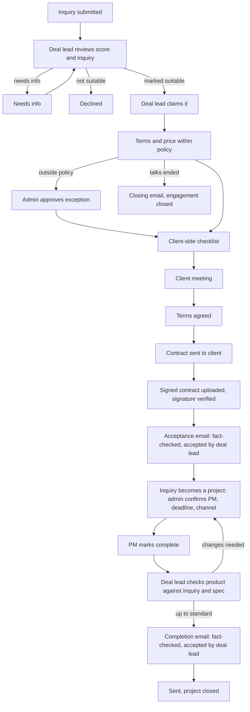

# Kiln Studio: Stage 2 Plan (small-team edition)

Evaluation, negotiation, meetings, contract, and completion flow, sized for a studio of a few people.

**Status: partially implemented.** The README lists the shipped demo behavior.
The implemented first slice is deal-lead review, suitability notes, first-claim-
wins ownership, studio-member reassignment, a protected engagement workspace,
and database-enforced acceptance gating. Pricing, negotiation, meetings,
contracts, emails, and completion review remain design-only. The demo uses
synthetic data, so no email is sent to real addresses and no contract is
legally binding.

This is the plan for the studio as it is now. The full design for a larger team
(separate evaluators, negotiators, and a head evaluator) is kept in
`kiln-scaling-plan.md`, with a migration path at the end of this document.

## Why an inquiry system

- The form collects what the studio needs to scope and price the work.
- It sets the expectation that a request is reviewed and negotiated, not auto-accepted.
- It filters out low-effort requests.
- Design hypothesis (the author's reasoning, not a proven claim): applying for something makes the studio feel more legitimate than assured attention would.

## What changed from the full plan

- The evaluator and negotiator are **one universal role: the deal lead.** (The name can be changed; the role key is `deal_lead`.)
- There is no head evaluator and no separate evaluator in-charge. The **admin** (the founder or owner) covers oversight, and the deal lead who owns an engagement covers the in-charge duties.
- The two-person checks are replaced by checks that work with few people: policy ranges enforced in the database, admin approval for exceptions only, a required two-step "studio side, then client side" review, automated fact-checking of AI emails, and an audit trail.
- Emails have one human reviewer instead of two.
- There are fewer tables, and no engagement-assignment table until the team grows.

## Roles

| Role | Scope | Responsibility |
| --- | --- | --- |
| Admin | Universal | Owner and oversight. Appoints deal leads and PMs, maintains the pricing policy, approves exceptions, reassigns engagements, and sees everything. |
| Deal lead | Universal | Reviews inquiries and scores, marks them suitable, claims engagements, sets terms and price within policy, checks the client's side, attends client meetings, runs the contract, accepts both client emails, and checks the finished product against the spec. |
| Designer | Universal | As today. |
| Client | Universal | As today. |
| Project manager and members | Per project | As today. |

The deal lead who owns an engagement is its project-wise role. It is stored on the engagement and carried onto the project at conversion.

**Solo case:** one person may hold both the admin and deal lead roles. Everything still works, but exception approvals made by the same person who requested them are flagged in the audit feed.

### Who appoints whom

| Appointment | Appointed by | Rule |
| --- | --- | --- |
| Admin | Provisioned privately (as today) | No public sign-up |
| Deal lead | Admin | Stored in trusted app metadata; every grant is audited |
| Engagement owner | The deal lead who claims it (first claim wins); the admin can reassign | Only a deal lead can own one |
| Project manager | Admin, as today | The deal lead proposes one in the plan; the admin confirms at conversion |
| Pricing policy | Admin maintains it | Versioned |

An **engagement** is one inquiry followed through to its finished project.

### Who does what

| Step | Acts | Approves or checks | Notified |
| --- | --- | --- | --- |
| Review inquiry and score | Deal lead marks it suitable, not suitable, or needs info | none | Admin (when marked suitable) |
| Claim | The deal lead who will own it | none | Admin |
| Terms and price (studio side) | Deal lead, within the pricing policy | Database range check | none |
| Client-side check | Same deal lead completes the checklist | System requires every item | none |
| Exception (price or terms outside policy) | Deal lead requests, with a reason | Admin approves | Admin |
| Client meeting | Deal lead schedules and attends | none | Attendees; client by email |
| Terms agreed | Deal lead records the meeting outcome and marks agreed | none | Admin |
| Contract | System generates it once terms are agreed; client signs | System verifies the signature | Deal lead |
| Acceptance email | AI draft | Automated fact check, then deal lead accepts | Client (after sending) |
| Project creation | System, in one atomic step | Admin confirms the PM | PM, designers, admin |
| Completion | PM marks complete | Deal lead checks the product against the spec | Admin |
| Completion email | AI draft | Automated fact check, then deal lead accepts | Client (after sending) |

### Who can see what

| Item | Client | Designer / PM | Deal lead | Admin |
| --- | --- | --- | --- | --- |
| Inquiry, brief, score | Own | Own project | All | All |
| Evaluation notes | none | none | All | All |
| Pricing policy | none | none | Read | Read and edit |
| Terms, price, negotiation notes | none | none | All (acts only on own) | All |
| Plan | none | Own project | All | All |
| Contract | Own copy | none | All | All |
| Meetings | Own | Only if attending | All | All |
| Emails | Sent ones only | none | All | All |

Deal leads can read every engagement so they can cover for each other, but they can change only the engagements they own. Pricing and terms are never visible to designers or to the public assistant.

## Policing without a second person

With one person wearing both hats, you lose a fully independent check. These controls replace it:

1. **Policy range in the database.** A price or term outside the pricing policy is rejected unless the admin has approved an exception with a recorded reason.
2. **Two-step review.** The system requires the deal lead to finish the studio side (terms and price) first, then a client-side checklist: scope matches the brief, deliverables and revision limits are written down, the deadline is realistic, payment terms are clear, and nothing promised falls outside policy. The contract cannot be generated until both are complete. The checklist is a structured prompt, not an independent person, and is recorded for audit.
3. **Admin approval for exceptions only.** Routine deals do not wait on the admin. Exceptions and price-changing amendments do.
4. **Automated fact check on AI emails.** Before a draft can be accepted, the system compares its price, dates, names, and deliverables against the database and blocks acceptance on a mismatch.
5. **State changes only through database functions.** Each transition is checked in Postgres (right role, right current state, right owner), so two people acting at once cannot corrupt the state.
6. **Audit trail.** Every transition, exception, and self-approval writes to the audit feed that already exists. Self-approved exceptions are flagged.
7. **Soft separation of duties.** If the same person marks a project complete and accepts it, it is flagged, not blocked.

## Lifecycle

## Stage notes

**Review and claim.** The deal lead reviews the priority score, brief, references, and similarity advisory (similarity stays advisory). Marking an inquiry suitable puts it in a claim queue, and the first deal lead to claim it owns it. A claim is atomic in the database. The admin is reminded if a suitable inquiry stays unclaimed.

**Terms and client check.** Terms and price are stored in a separate table from the engagement because row-level security protects whole rows, and price must stay hidden from anyone who can see the engagement itself. Internal pricing bounds are never visible to clients or the public assistant.

**Meetings.** A normal database table is the source of truth, and calendar integration is optional later. Each meeting has a type (negotiation, kickoff, review), time in UTC, link, status, attendees, and outcome notes. The `my_meetings` view returns each person's meetings, upcoming first (soonest first), then recent past (latest first). Supabase Realtime pushes changes.

**Contract and conversion.**
- A contract is generated from a template using the agreed plan, terms, price, and deadline.
- Prefer an e-signature provider that confirms completion through a signed webhook over inspecting an uploaded PDF.
- Demo: signing is simulated (typed name, timestamp, and the hash of the contract version) and labeled not legally binding.
- Store the file hash, signer, timestamp, and an audit entry.
- Legal validity depends on jurisdiction and signing method; confirm before any real use.
- Conversion is one atomic step: the inquiry is accepted, and the project, channel, PM, deadline, and members are created. The deal lead is carried over.

**Completion check.** The inquiry's spec items and the plan are copied into a checklist when the project is created. At completion the deal lead marks each item met or not met, with a note. Anything unmet returns the project to the PM.

**AI emails.**
- The Google AI API drafts only the tailored paragraph, and a template supplies the fixed sections.
- Facts (price, dates, project name) come from the database, never from the model, and the automated fact check enforces it.
- Client-supplied text is untrusted input to the model, so pass structured fields where possible.
- Drafts are labeled AI-written, and nothing sends without the deal lead's acceptance. Editing a draft after acceptance resets it.
- In the demo, emails go to an outbox page, not to real addresses.
- Implementation: Upstash Workflow with `waitForEvent` for the review step, with timeouts and reminders.

## Rules that close the gaps

1. **Scope after signing is frozen.** A change needs an amendment (new terms and a contract addendum). It needs admin approval if the price changes.
2. **Talks fail.** The deal lead can end talks. The client gets a template-only closing email, and the engagement closes.
3. **Reassignment.** If a deal lead is unavailable, the admin reassigns.
4. **Timers (defaults, tunable), run with Workflow sleep and reminders:**
   - Marked suitable but unclaimed: 2 days (reminder to the admin)
   - Terms offer valid: 14 days (client reminder at day 7)
   - Contract valid: 14 days (client reminder at day 7), then it expires
   - Completion check after the PM marks complete: 3 days (reminder to the deal lead)
5. **Client timeline.** The client sees a plain status timeline: submitted, in review, in talks, contract sent, project active, complete.

## Data model additions

| Table | Purpose |
| --- | --- |
| `engagements` | One per inquiry in review. State, owner (`deal_lead_id`), suitability decision, notes, score snapshot, claimed time, closed reason |
| `pricing_policies` | Service type, min, max, rules, version, edited by (internal only) |
| `engagement_terms` | Proposed price and terms, client-check items and completion time, agreed time, exception request, approver, and reason |
| `engagement_plans` | Scope, milestones, deadline, proposed PM, spec items |
| `amendments` | Change description, new terms, approvals |
| `meetings` | Inquiry, optional project, type, title, time (UTC), link, status, outcome notes, created by |
| `meeting_attendees` | Meeting, staff user or client contact, attendee role |
| `contracts` | Template version, signed file reference, file hash, signature status, signer, timestamps |
| `completion_reviews` | Project, reviewer, status, per-item results, notes |
| `outbound_emails` | Kind (acceptance, completion, closing), AI draft, final text, fact-check result, status, reviewed by, approved and sent times |
| `email_templates` | Fixed sections per email kind |

Views: `my_meetings`. Every state change writes an audit entry.

## Access rules (RLS)

- Admin and deal lead come from trusted app metadata claims. Ownership is checked through helper functions such as `is_engagement_owner(engagement_id)`.
- The "Who can see what" table above is the policy. Each row becomes policies with pgTAP tests, including leak checks (a designer must never read terms, and a deal lead must not change an engagement they do not own).
- The public assistant has no access to any of these tables.

## Build order

1. Deal lead role, `engagements`, RLS helpers, and the state-transition functions
2. Completion check and completion email, with human review and the fact check (independent of the contract flow)
3. Review, suitable decision, and the claim queue
4. Pricing policy, terms, client-side checklist, and exceptions
5. Meetings table and view
6. Contract, acceptance email, and conversion
7. Calendar integration (optional)

## Growing into the full plan

When the team grows, each piece below splits into the larger design in `kiln-scaling-plan.md`.

| Small-team piece | Becomes in the full plan | How to migrate |
| --- | --- | --- |
| Deal lead role | Separate evaluator and negotiator roles | Add the roles; existing deal leads keep working until reassigned |
| `engagements.deal_lead_id` | `engagement_assignments` (evaluator in-charge and negotiator) | Create the table and backfill both roles from `deal_lead_id` |
| Admin oversight (assign, exceptions, policy) | Head evaluator | Add the role and move those approvals to it |
| Client-side checklist | In-charge agrees on terms (the two-person rule) | The checklist becomes the in-charge's review form |
| Claim queue | Head evaluator assigns the team | Add the assign step; keep the claim as an option |
| Single email reviewer | Both reviewers, with the in-charge giving final acceptance | Add `email_reviews` |
| Deal lead checks the product | Evaluator in-charge checks it | Same data, a different person |

Reasonable signals to move: deals outgrow one owner each, the same person keeps approving their own exceptions, or price and quality disputes show that an independent second check is worth its cost.