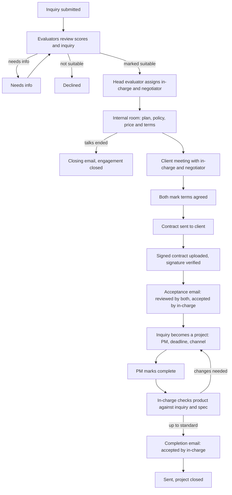

# Kiln Studio: Scaling Plan (full evaluation and negotiation team)

The full design for a larger studio, kept as a scaling idea. The plan for the current small team is `kiln-small-team-plan.md`; this one describes where it grows when the team does.

Evaluation, negotiation, meetings, contract, and completion flow.

**Status: design only.** Nothing in this document is implemented unless the README says so. The demo uses synthetic data, so no email is sent to real addresses and no contract is legally binding.

All earlier open questions are settled below. Each decision can be changed, but the plan is complete as written.

## Why an inquiry system

- The form collects what the studio needs to scope and price the work.
- It sets the expectation that a request is reviewed and negotiated, not auto-accepted.
- It filters out low-effort requests.
- Design hypothesis (the author's reasoning, not a proven claim): applying for something makes the studio feel more legitimate than assured attention would.

## At a glance

### Who appoints whom

| Appointment | Appointed by | Rule |
| --- | --- | --- |
| Admin | Provisioned privately (as today) | No public sign-up |
| Head evaluator, evaluator, negotiator (universal roles) | Admin | Stored in trusted app metadata; every grant is audited |
| Evaluator in-charge (per engagement) | Head evaluator | Must hold the evaluator or head evaluator role |
| Assigned negotiator (per engagement) | Head evaluator | Must hold the negotiator role; cannot also be the in-charge |
| Project manager | Admin, as today | The in-charge proposes one in the plan; the admin confirms at conversion |
| Pricing policy (ranges and rules) | Head evaluator maintains it | Versioned |

An **engagement** is one inquiry followed through to its finished project. "Own deal" below means an engagement the person is assigned to.

### Who does what

| Step | Acts | Approves or agrees | Notified |
| --- | --- | --- | --- |
| Review inquiry and score | Any evaluator marks it suitable, not suitable, or needs info | Head evaluator can override | Head evaluator (when marked suitable) |
| Assign the team | Head evaluator | none | In-charge and negotiator |
| Terms and price | Negotiator | In-charge agrees | Head evaluator on a deadlock |
| Plan (scope, milestones, deadline, proposed PM) | In-charge | Negotiator agrees | Head evaluator |
| Client meeting | Negotiator schedules; both attend | none | Attendees; client by email |
| Contract | System generates it once both agree; client signs | System verifies the signature | In-charge, negotiator |
| Acceptance email | AI draft | In-charge and negotiator review; in-charge gives final acceptance | Client (after sending) |
| Project creation | System, in one atomic step | none | PM, designers, admin |
| Completion | PM marks complete | In-charge checks the product against the spec | Head evaluator |
| Completion email | AI draft | In-charge accepts; negotiator is notified and may flag an issue | Client (after sending) |

### Who can see what

| Item | Client | Designer / PM | Evaluator | In-charge | Negotiator | Head evaluator | Admin |
| --- | --- | --- | --- | --- | --- | --- | --- |
| Inquiry, brief, score | Own | Own project | All | All | Own deal | All | All |
| Evaluation notes | none | none | All | All | Own deal | All | Status only |
| Pricing policy | none | none | Read | Read | Read | Read and edit | none |
| Negotiation notes and terms | none | none | none | Own deal | Own deal | All | Status only |
| Plan | none | Own project | none | Own deal | Own deal | All | Scope and deadline |
| Contract | Own copy | none | none | Own deal | Own deal | All | Status only |
| Meetings | Own | none | none | Own deal | Own deal | All | none |
| Emails and reviews | Sent ones only | none | none | Own deal | Own deal | All | Status only |

"Status only" means the stage and timestamps, never the content.

## Roles

**Universal roles**

- **Head evaluator:** oversees every evaluation, assigns the in-charge and negotiator, reassigns when someone is unavailable, decides deadlocks, maintains the pricing policy, and can approve a price outside it with a recorded reason. Has every evaluator permission.
- **Evaluator:** reviews inquiries and scores and marks them suitable. Can be assigned as in-charge.
- **Negotiator:** sets the terms and the price, on the studio's side.

**Project-wise roles**

- **Evaluator in-charge:** one per engagement. Speaks for the client's needs and for quality. Shapes the plan with the negotiator, attends the client meeting, checks the finished product against the original inquiry and spec, and gives final acceptance on the client emails.
- **Assigned negotiator:** the negotiator for this engagement.
- **Project manager and members:** as today.

The in-charge works on the deal before a project exists, so assignments attach to the **inquiry** and are carried onto the project at conversion.

## Rules that close the gaps

1. **Two-person rule on terms.** The contract is generated only when the negotiator and the in-charge have both marked the terms agreed. They settle disagreements in the internal room, so the client meets one agreed position.
2. **Deadlock.** If they cannot agree, the head evaluator decides.
3. **Price outside the policy range.** Needs head evaluator approval with a recorded reason.
4. **Suitable decision.** One evaluator's decision is enough. The head evaluator's assignment step is the second check and can send the inquiry back.
5. **Reassignment.** If an assignee is unavailable, the head evaluator reassigns. The old assignment stays in history as inactive.
6. **Separation of duties.** One person cannot be both the in-charge and the negotiator on the same engagement. This is enforced in the database.
7. **One internal room per engagement.** It persists from assignment through completion (head evaluator, in-charge, negotiator). There is no separate evaluation channel. The in-charge or head evaluator can invite other evaluators for a second opinion.
8. **Acceptance email:** needs both reviewers, and the in-charge gives final acceptance, because the email carries price and terms.
9. **Completion email:** the in-charge accepts. The negotiator is notified and can flag an issue. A flag pauses sending until the in-charge responds.
10. **Only the system sends.** Editing a draft after approval resets the approvals. The sent version is stored and audited.
11. **Scope after signing is frozen.** A change needs an amendment: a new negotiation entry, a contract addendum, both agreeing, and head evaluator approval if the price changes.
12. **Talks fail.** Either assignee can propose "talks ended", the head evaluator confirms, and the client gets a template-only closing email accepted by the in-charge.
13. **Timers (defaults, tunable), run with Workflow sleep and reminders:**
    - Marked suitable to assigned: 2 days (reminder to the head evaluator)
    - Terms offer valid: 14 days (client reminder at day 7)
    - Contract valid: 14 days (client reminder at day 7), then it expires
    - Completion check after the PM marks complete: 3 days
14. **State changes only through database functions.** A transition is checked in Postgres (right role, right current state, right assignment), so two people acting at once cannot corrupt the state.
15. **Meeting times are stored in UTC** with the attendee's time zone for display.
16. **Client timeline.** The client sees a plain status timeline: submitted, in review, in talks, contract sent, project active, complete.

## Lifecycle

## Meetings

- A normal database table is the source of truth. Calendar integration is optional later.
- Each meeting has a type (negotiation, kickoff, review), time, link, status, attendees, and outcome notes.
- The `my_meetings` view returns each team member's meetings: upcoming first (soonest first), then recent past (latest first).
- Supabase Realtime pushes changes so everyone sees the latest details.

## Contract and signature

- A contract is generated from a template using the agreed plan, terms, price, and deadline.
- Prefer an e-signature provider that confirms completion through a signed webhook over inspecting an uploaded PDF.
- Demo: signing is simulated (typed name, timestamp, and the hash of the contract version) and labeled not legally binding.
- Store the file hash, signer, timestamp, and an audit entry.
- Legal validity depends on jurisdiction and signing method; confirm before any real use.
- Conversion is one atomic step: the inquiry is accepted, and the project, channel, PM, deadline, and members are created. The in-charge and negotiator are carried over.

## Completion check

- The inquiry's spec items and the plan are copied into a checklist when the project is created.
- At completion the in-charge marks each item met or not met, with a note.
- Anything unmet returns the project to the PM.

## AI emails

- The Google AI API drafts the tailored paragraph, and a template supplies the fixed sections.
- Facts (price, dates, project name) come from the database, never from the model.
- Client-supplied text is untrusted input to the model, so pass structured fields where possible.
- Drafts are labeled AI-written for the reviewers.
- In the demo, emails go to an outbox page, not to real addresses.
- Implementation: Upstash Workflow with `waitForEvent` for each review step, with timeouts and reminders.

## Data model additions

| Table | Purpose |
| --- | --- |
| `engagement_assignments` | inquiry, optional project, user, role (`evaluator_in_charge` or `negotiator`), assigned by, active. One active in-charge per inquiry; holder must have the evaluator role; in-charge and negotiator must differ |
| `evaluations` | inquiry, evaluator, decision, score snapshot, notes |
| `pricing_policies` | service type, min, max, rules, version, edited by (internal only) |
| `negotiations` | inquiry, status, proposed price and terms, client-side notes, each side's agreed time, agreed price and terms, override approver and reason |
| `engagement_plans` | inquiry, scope, milestones, deadline, proposed PM, spec checklist items |
| `amendments` | engagement, change description, new terms, approvals |
| `meetings` | inquiry, optional project, type, title, time (UTC), link, status, outcome notes, created by |
| `meeting_attendees` | meeting, staff user or client contact, attendee role |
| `contracts` | template version, signed file reference, file hash, signature status, signer, timestamps |
| `completion_reviews` | project, in-charge, status, notes |
| `completion_checklist_items` | review, requirement, met or not, note |
| `outbound_emails` | kind (acceptance, completion, closing), AI draft, final text, status, sent time |
| `email_reviews` | email, reviewer, capacity (in-charge or negotiator), decision or flag, comment |
| `email_templates` | fixed sections per email kind |

Views: `my_meetings`. Every state change writes an audit entry.

## Access rules (RLS)

- Universal roles come from trusted app metadata claims. Project-wise roles are looked up from `engagement_assignments` through helper functions such as `is_in_charge(inquiry_id)` and `is_assigned_negotiator(inquiry_id)`.
- The "Who can see what" table above is the policy. Each row becomes policies with pgTAP tests, including cross-engagement leak checks (an in-charge must not read another engagement's terms).
- The public assistant has no access to any of these tables.

## Build order

1. Roles, `engagement_assignments`, RLS helpers, and the state-transition functions
2. Completion check and completion email, with human review (independent of the contract flow)
3. Evaluation and assignment
4. Internal room, pricing policy, and negotiation
5. Meetings table and view
6. Contract, acceptance email, and conversion
7. Calendar integration (optional)